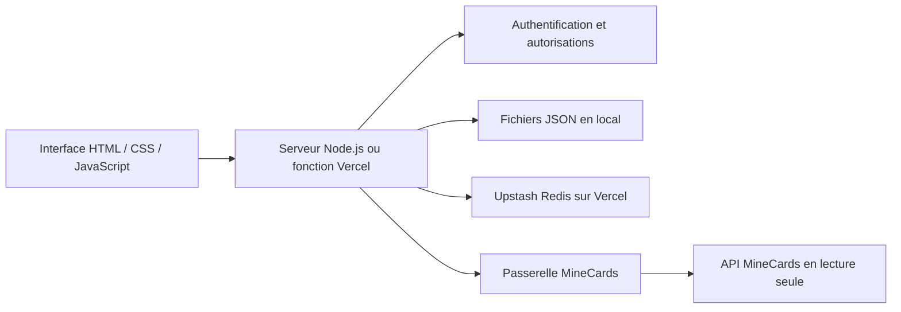

# Architecture de MineCards TCG

## Vue d’ensemble

Le serveur n’utilise ni Express ni un framework de base de données. L’interface est une application à onglets ; les opérations passent par `/api/*` sur la même origine.

## Stockage

### Local

`server.js` utilise `data/accounts.json`, avec sauvegarde dans un fichier temporaire puis renommage. Les connexions MineCards sont isolées dans `data/minecards-connections.json`. Sessions et limitations de tentatives restent en mémoire. Le serveur écoute sur `127.0.0.1`.

### Vercel

`VERCEL=1` active le stockage cloud. `storage.js` utilise l’API REST Redis via `fetch`, sans SDK supplémentaire.

Le document `<MINECARDS_STORAGE_PREFIX>:state` contient comptes, connexions MineCards, sessions, tentatives de connexion et état des synchronisations. Le verrou distribué `<préfixe>:lock` sérialise les transactions entre instances. `AsyncLocalStorage` associe l’état à la requête courante.

Une commande Lua confirme la propriété du verrou avant d’enregistrer le document et de libérer le verrou. Le serveur retient la réponse API jusqu’à cette confirmation. Les sessions expirées sont nettoyées lors des transactions. Le verrou expire après 270 secondes ; la fonction dispose de 240 secondes.

Ce modèle vise une petite application personnelle. Les lectures partagent aussi le verrou. Une synchronisation longue peut rendre une autre opération temporairement indisponible (`503`). Pour une forte activité simultanée, prévoir des enregistrements individuels et des opérations plus ciblées.

## Compte et authentification

Chaque compte possède un identifiant stable, un nom de connexion, un rôle, un profil, ses cartes locales, ses favoris et éventuellement une copie MineCards.

- Nom de connexion normalisé en minuscules.
- Mot de passe haché par `scrypt` avec sel individuel aléatoire.
- Jeton aléatoire de session, recherché par son empreinte SHA-256.
- Cookie `HttpOnly`, `SameSite=Strict`, durée de sept jours, `Secure` sur Vercel.
- Vérification d’origine et contrôle des droits dans les routes serveur.
- Changement de mot de passe : contrôle de l’ancien, renouvellement de la session et révocation des autres sessions.

## Collection et synchronisation

Les cartes locales historiques et les cartes importées sont stockées séparément. `collectionData()` les fusionne pour l’affichage et l’administration ; `localData()` évite de recopier les entrées importées comme cartes locales lors d’une sauvegarde ordinaire.

Les entrées importées ont un identifiant local négatif et des métadonnées `_minecards` : identifiant du catalogue et quantité disponible. Les noms historiques reconnus sont reliés à des identifiants stables.

La synchronisation :

1. Lit toutes les pages de `me/cards`, en vérifiant quantités et pagination.
2. Écarte les entrées sans exemplaire disponible.
3. Vérifie les puissances officielles `power`.
4. Construit une copie, conserve l’attaque/défense déjà importées et actualise les images.
5. Actualise les cartes correspondantes des favoris et leurs totaux.
6. Enregistre seulement après la lecture complète ; une erreur conserve la collection précédente.

En local, le bouton lance un travail en mémoire, répond `202` et l’interface consulte l’avancement. Sur Vercel, la synchronisation est attendue dans la requête et répond `200` à sa fin. Le budget de lecture est de 200 secondes, avec un délai réseau de 20 secondes par appel.

La file espace les lectures de 1,1 seconde ; le cache dure 30 secondes. En cloud, le dernier instant de lecture et le délai de blocage sont persistés ; le cache reste lié à l’instance. `429` est traité avec `Retry-After`.

## Decks et profil

Le créateur trie les cartes distinctes puis cherche le trio le plus proche d’une cible avec un parcours à deux pointeurs. Sa complexité est quadratique après tri. Le trio maximal du profil sélectionne les trois cartes distinctes de puissance maximale.

Les favoris sont des instantanés de cartes avec nom, cible, total et date. Le favori mis en avant est référencé par son identifiant dans le profil ; le serveur vérifie son appartenance au compte.

Les doublons sont les exemplaires supplémentaires après en avoir conservé un par carte différente. Aucune statistique de combat ou d’ouverture de booster n’est inventée.

## Médias

JPG, PNG et WebP sont acceptés, jusqu’à 10 Mio avant traitement. Le navigateur recadre au centre et compresse vers 320 × 320 pixels pour la photo, 1200 × 360 pour la bannière. Le serveur vérifie le format, la signature binaire et les plafonds de 80 Kio / 180 Kio. Les images sont encodées dans le profil ; les avatars par icônes restent disponibles.

## Build et limites

`scripts/build.js` contrôle la syntaxe du JS externe et embarqué, puis copie une liste explicite de cinq assets dans `public/`. Il refuse les fichiers inattendus. La fonction passe par `api/index.js` et `server.js`.

- API MineCards consultée uniquement, sans écriture distante.
- Aucun compte ni administrateur précréé dans le dépôt.
- Aucune récupération automatique de mot de passe par email.
- Copies locale et cloud indépendantes après migration.
- Corps de requête limité à 4 Mio ; quotas du stockage applicables.
- CDN et API nécessitant un accès réseau.
- Pas de suite de tests fonctionnels ; build limité aux contrôles de syntaxe et assets.
