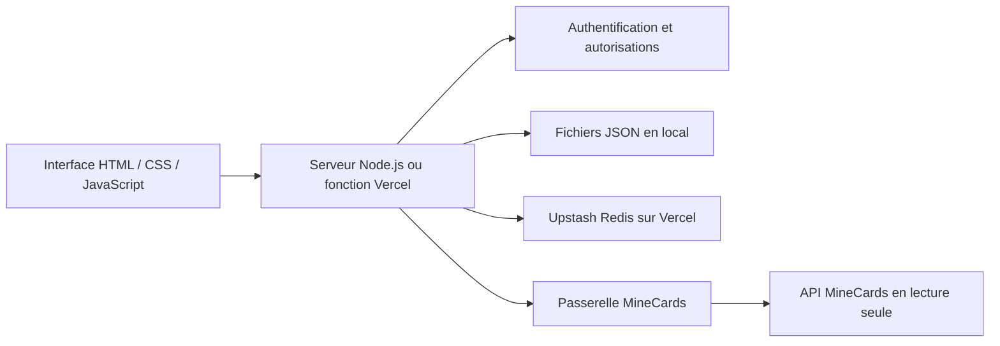

# Architecture de MineCards TCG

## Vue d’ensemble

Le serveur n’utilise ni Express ni un framework de base de données. L’interface est une application à onglets ; les opérations passent par `/api/*` sur la même origine.

## Stockage

### Local

`server.js` utilise `data/accounts.json`, avec sauvegarde dans un fichier temporaire puis renommage. Les connexions MineCards sont isolées dans `data/minecards-connections.json`. Sessions et limitations de tentatives restent en mémoire. Le serveur écoute sur `127.0.0.1`.

### Vercel

`VERCEL=1` active le stockage cloud. `storage.js` utilise l’API REST Redis via `fetch`, sans SDK supplémentaire.

Le document `<MINECARDS_STORAGE_PREFIX>:state` contient comptes, connexions MineCards, sessions, tentatives de connexion et état des synchronisations. Le verrou distribué `<préfixe>:lock` sérialise les transactions entre instances. `AsyncLocalStorage` associe l’état à la requête courante.

Une commande Lua confirme la propriété du verrou avant d’enregistrer le document et de libérer le verrou. Le serveur retient la réponse API jusqu’à cette confirmation. Les sessions expirées sont nettoyées lors des transactions. Le verrou expire après 270 secondes ; la fonction dispose de 240 secondes.

Ce modèle vise une petite application personnelle. Les lectures partagent aussi le verrou. Les étapes de synchronisation libèrent ce verrou pendant l'attente réseau ; les autres routes, dont les lectures de l'explorateur, restent sérialisées pendant leur traitement. Une contention reste possible (`503`). Pour une forte activité simultanée, prévoir des enregistrements individuels et des opérations plus ciblées.

## Compte et authentification

Chaque compte possède un identifiant stable, un nom de connexion, un rôle, un profil, ses cartes locales, ses favoris et éventuellement une copie MineCards.

- Nom de connexion normalisé en minuscules.
- Mot de passe haché par `scrypt` avec sel individuel aléatoire.
- Jeton aléatoire de session, recherché par son empreinte SHA-256.
- Cookie `HttpOnly`, `SameSite=Strict`, durée de sept jours, `Secure` sur Vercel.
- Vérification d’origine et contrôle des droits dans les routes serveur.
- Changement de mot de passe : contrôle de l’ancien, renouvellement de la session et révocation des autres sessions.

## Collection et synchronisation

Les cartes locales historiques et les cartes importées sont stockées séparément. `collectionData()` les fusionne pour l’affichage et l’administration ; `localData()` évite de recopier les entrées importées comme cartes locales lors d’une sauvegarde ordinaire.

Les entrées importées ont un identifiant local négatif et des métadonnées `_minecards` : identifiant du catalogue et quantité disponible. Les noms historiques reconnus sont reliés à des identifiants stables.

La synchronisation :

1. Lit toutes les pages de `me/cards`, en vérifiant quantités et pagination.
2. Écarte les entrées sans exemplaire disponible.
3. Vérifie les puissances officielles `power`.
4. Construit une copie, conserve l’attaque/défense déjà importées et actualise les images.
5. Actualise les cartes correspondantes des favoris et leurs totaux.
6. Enregistre seulement après la lecture complète ; une erreur conserve la collection précédente.

En local comme sur Vercel, `POST /sync` démarre ou retrouve un travail et répond `202`. Le navigateur conduit ensuite les appels `POST /sync/step` page par page. `minecards-sync.js` réserve une page et un créneau de quota dans une transaction, appelle `minecards-remote.js` hors du verrou Redis (délai réseau de 20 secondes), puis valide la page dans une seconde transaction. La session et l'empreinte de connexion sont vérifiées aux deux étapes. Un bail par page et les identifiants travail/page empêchent un retour ancien ou un deuxième onglet de doubler une page.

Les pages sont stockées provisoirement dans le travail (mémoire en local, document privé Redis sur Vercel). Seule la dernière page remplace la collection et rafraîchit les favoris, dans la même validation atomique. La réponse finale inclut les données d'affichage et évite une lecture supplémentaire, sauf si une sauvegarde utilisateur intervenue pendant l'import impose une relecture. Une sauvegarde de favori concurrente conserve les dernières images et puissances du catalogue déjà validé.

Un travail interrompu se reprend pendant 15 minutes après son démarrage ; fermer l'onglet suspend les étapes. Un redémarrage du serveur local perd le travail provisoire, tandis que Vercel le conserve dans Redis. Deux nouvelles tentatives sont possibles par page en cas de panne temporaire. Une modification de clé invalide le travail. Les pages provisoires, baux et empreintes ne sont jamais exposés dans `/status`.

L'interface affiche le nombre de pages lues et de cartes reçues, sans inventer de pourcentage quand le total est inconnu. L'actualisation automatique est proposée toutes les 30 secondes dans un onglet visible, hors saisie et édition ; retour sur l'onglet et reconnexion réseau déclenchent aussi une actualisation si nécessaire. Les appels simultanés partagent une seule promesse. Un changement de profil annule la lecture côté navigateur et empêche un ancien retour d'actualiser le nouveau profil. Les cartes et favoris identiques ne sont pas redessinés.

La file espace les lectures de 1,1 seconde. Les réponses ne sont pas mises en cache et les appels `fetch` utilisent `cache: 'no-store'`, conformément à la documentation du fournisseur. La copie de collection explicitement synchronisée reste persistante. En cloud, le dernier instant de lecture et le délai de blocage sont persistés. Le client respecte `Retry-After`, ainsi que `X-RateLimit-Remaining: 0` et `X-RateLimit-Reset` pour attendre la prochaine fenêtre. Le délai est transmis au navigateur dans le JSON et l’en-tête `Retry-After` des erreurs `429`.

Chaque liste est contrôlée : tableau, page et limite attendues, `hasMore` et `nextPage` cohérents. Un identifiant dupliqué entre pages ou différent de celui de la carte annule l’import. À la page 1 000, `hasMore: true` avec `nextPage: null` est accepté pour l’explorateur mais interdit pour une synchronisation : un inventaire partiel ne remplace jamais la dernière copie complète.

## Decks et profil

Le créateur trie les cartes distinctes puis cherche le trio le plus proche d’une cible avec un parcours à deux pointeurs. Sa complexité est quadratique après tri. À écart égal, le total sous la cible est préféré. Le mode plafond garde uniquement les sommes inférieures ou égales à la limite ; le mode maximum sélectionne les trois cartes différentes de puissance maximale, comme le profil.

L’identité stable `_minecards.cardId` prime pour les cartes importées. Les noms normalisés servent aux anciennes cartes locales et à éviter leur duplication avec une carte importée. Deux identifiants distants distincts peuvent partager un nom. Les quantités nulles ou les puissances absentes / invalides sont exclues. `active` concerne les boosters et ne bloque pas une carte possédée. `_minecards.power` conserve la dernière puissance officielle, également reportée dans `valeur` ; l’attaque et la défense historiques restent inchangées. Les favoris utilisent des copies des cartes et leur enregistrement attend une confirmation serveur. Une modification de disponibilité ou de puissance invalide le résultat courant avant une nouvelle sauvegarde.

Les favoris sont des instantanés de cartes avec nom, cible, total et date. Le favori mis en avant est référencé par son identifiant dans le profil ; le serveur vérifie son appartenance au compte.

Les doublons sont les exemplaires supplémentaires après en avoir conservé un par carte différente. Aucune statistique de combat ou d’ouverture de booster n’est inventée.

Le mode tactique utilise `arena-rules.js` dans le navigateur et sur le serveur : trois créatures, jusqu’à deux soutiens, coût total de 18 points, statistiques de combat distinctes des attributs historiques. `arena-builder.js` gère la sélection, l’ordre, les postures, les conseils de terrain et les lectures d’arènes via la passerelle existante. Le choix automatique utilise un score heuristique explicite dans le code ; il ne simule pas les combats. Les nouvelles équipes favorites sont reconstruites depuis le stock importé côté serveur. Voir [ARENAS.md](ARENAS.md) pour les règles observées et les limites.

## Médias

JPG, PNG et WebP sont acceptés, jusqu’à 10 Mio avant traitement. Le navigateur recadre au centre et compresse vers 320 × 320 pixels pour la photo, 1200 × 360 pour la bannière. Le serveur vérifie le format, la signature binaire et les plafonds de 80 Kio / 180 Kio. Les images sont encodées dans le profil ; les avatars par icônes restent disponibles.

## Build et limites

`scripts/build.js` contrôle la syntaxe du JS externe et embarqué, puis copie une liste explicite de sept assets dans `public/`. Il refuse les fichiers inattendus. La fonction passe par `api/index.js` et `server.js`.

- API MineCards consultée uniquement, sans écriture distante.
- Aucun compte ni administrateur précréé dans le dépôt.
- Aucune récupération automatique de mot de passe par email.
- Copies locale et cloud indépendantes après migration.
- Corps de requête limité à 4 Mio ; quotas du stockage applicables.
- CDN et API nécessitant un accès réseau.
- Pas de suite de tests fonctionnels ; build limité aux contrôles de syntaxe et assets.
